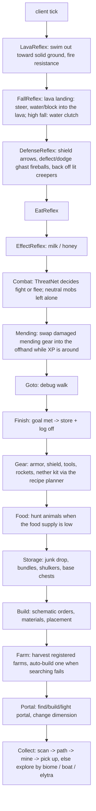

# autoCraft — build plan

Client-side Fabric mod. You give it resources + amounts; it survives, paths, mines, crafts tools,
travels to the Nether when a resource lives there, builds farms or your own schematics, stores loot and
logs off when the goal is met.

## Stack
- Minecraft **26.3**, Fabric Loader 0.19.5, Fabric API, Java 25, Loom (`./gradlew build`, `./gradlew runClient`).
- Mojang names (26.x is unobfuscated — no mappings).
- No external AI libs: the neural net is a tiny MLP in plain Java. Recipes come from the game jar's own data.

## Commands (typed in chat, never sent to the server)
| Command | Effect |
|---|---|
| `!ac collect <resource> <amount> [<resource> <amount> ...]` | start a job (`diamond 10 iron 32 quartz 64`) |
| `!ac build <schematic> <x> <y> <z> [0\|90\|180\|270]` | build a schematic with its corner at x y z (`~` = relative), optionally rotated |
| `!ac build <schematic> here [rotation]` | same, corner at your feet |
| `!ac farm <resource> [<x> <y> <z> \| here] [rotation]` | build a farm for a resource (site chosen automatically without a position) |
| `!ac schematics` | list built-in and user schematics, show the schematic folder |
| `!ac built` | list everything the bot has built (farms are reused by jobs) |
| `!ac stop` / `!ac pause` / `!ac resume` | control the job |
| `!ac status` | progress, current behavior, build, prerequisite, health/food |
| `!ac base` | mark current position as the storage base (chests near it are used) |
| `!ac logoff on\|off` | disconnect when the job is done (default on) |
| `!ac goto <x> <y> <z>` | debug: pathfind to a block |
| `!ac resources` | list known resource names (any natural block's item id also works) |

## Architecture
One client-tick loop. Every tick the `Bot` releases all inputs, then asks behaviors **in priority
order**; the first that returns `true` owns the tick (subsumption). Lower behaviors keep their state
and resume when higher ones let go. Planners that need materials (tools, build materials, portal
obsidian) post a **need** on the bot; the collector serves needs before the job. Elytra flights take
over the loop (only the lava/fall reflexes can interrupt) until landing.

| Package | Responsibility |
|---|---|
| `com.autocraft` | entrypoint, `Bot` (job, build order, needs, behavior loop, flights), chat logging |
| `command` | `!ac` chat command parser |
| `goal` | `Job`, `Requirement` (items, sources, strategy, Y level, dimension, biomes), `Resources` registry |
| `world` | `WorldScanner` (nearest-ring, section-skipping block scan; entities), `BlockUtil`, `BiomeFinder` |
| `control` | `Controls` (keys, rotation, mine/attack/place/use), `InvUtil`, `ContainerOpener`, `Placement` |
| `path` | incremental A* `Pathfinder` (walk, diagonal, jump-up, staircase, safe fall, dig-down, pillar, bridge, mine-through, swim), goals, executor, `Navigator` |
| `behavior` | the priority behaviors above + `Harvest`, `BaseDeposit` |
| `ai` | `ThreatNet` MLP + online training, persisted to `config/autocraft/threatnet.json` |
| `craft` | `RecipeBook` (all vanilla crafting/smelting recipes from the game data), cost-based `Planner`, `Gatherable`, `Workshop` (crafter + smelter + station pickup) |
| `schematic` | `.litematic` / `.schem` / `.nbt` loading, built-in designs, `SchematicLibrary` (built-ins + user folder) |
| `build` | `BuildPlan` (rotation, wood swap, ordering, bill of materials), `PlacementSolver` (orientation), `Builder`, `SiteFinder`, `FluidFill`, `BaseWithdraw`, `StructureRegistry` (built + protected areas) |
| `travel` | boats over water/ice, elytra flights, nether portals (find, build, light, enter, return) |

### Neural net (ThreatNet)
Inputs: own health, armor, best weapon damage, shield, food, hostile count, nearest distance, summed
mob danger, creeper nearby, ranged count, flying shooters, night/nether. 12 tanh hidden units, sigmoid
output = “fighting is a good idea”. Bootstrapped on synthetic samples from a hand-written teacher so it
is sane on first run, then nudged online after every fight (won without losing >50% health → 1,
else → 0; ~10 consistent outcomes flip a decision) and saved.

### Schematics
- Put `.litematic` (Litematica), `.schem` (Sponge/WorldEdit) or `.nbt` (structure block) files in
  `config/autocraft/schematics/`, then `!ac build <file name> <x> <y> <z> [rotation]`.
- The builder clears the space, then places full blocks bottom-up, then partial/attached blocks, water,
  lava and finally plants. Orientation (stairs, logs, hoppers, observers, doors...) is solved by asking
  the block's own placement logic which view angle and clicked face give the wanted state.
- Missing materials come from base chests first, then the recipe planner (craft/smelt/mine, including
  trips to the Nether, e.g. quartz for observers). Items nothing can produce (string, slime, loot) are
  skipped with a message — put them in a base chest to include them.
- Farms: name a file `farm-<resource>-<anything>.litematic` and jobs for that resource can build and use
  it. Automatic farms (with chests/barrels) are emptied every couple of minutes; manual cane/tree/crop
  farms are harvested and replanted.
- Built-in: `starter_base` (7×7 hut with crafting table, furnace, double chest; becomes the base),
  `cobblestone_generator`, `sugar_cane_farm`, `tree_farm`, `wheat_farm`. Community farm schematics found
  online (redstone-schematics.org, Planet Minecraft, GitHub archives) mostly carry no clear license, so none
  are bundled — download the ones you like into the folder.

## Phases
| # | Phase | Status |
|---|---|---|
| 1 | **Skeleton** — Gradle/Loom project, entrypoint, `!ac` commands, `Bot` loop, logging | code complete |
| 2 | **Movement** — `Controls`, `BlockUtil`, incremental A* + executor, `!ac goto` | code complete |
| 3 | **Collection** — registry, scanner, mine + pick up, explore (ore Y level + tunnel; surface walk), log off | code complete |
| 4 | **Survival** — lava escape, fall/lava clutch, eating, hunting, milk, shield/back-off, ThreatNet combat | code complete |
| 5 | **Tools & crafting** — pickaxe tiers, data-driven recipe planner, 2x2 + table crafting, smelting, armor/shield, bucket | code complete |
| 6 | **Storage** — junk dropping (never job loot), bundles, shulker boxes, base chests with deposited counts | code complete |
| 7 | **Nether** — kit (gold boots, flint and steel, iron pickaxe, bucket, blocks, extra food); obsidian mined or cast; portals built/reused and remembered; trips home for materials or base storage; nether mob rules | code complete |
| 8 | **Travel** — boats over water/ice; elytra flights with rocket crafting and durability checks | code complete |
| 9 | **Biomes & mending** — biome-directed exploration; mending gear repaired in the offhand | code complete |
| 10 | **Schematics & farms** — user schematics, built-in starter base and farms, farm operation and auto-build | code complete |
| 11 | **Hardening** — in-game testing, stuck recovery, tuning thresholds from logs | next |

"Code complete" = compiles against the real 26.3 client jar; not yet run in-game (see Build).

## Build & test
- `./gradlew build` → `build/libs/autocraft-<version>.jar` (drop into `.minecraft/mods` with Fabric API).
- `./gradlew runClient` starts a dev client; try `!ac goto`, `!ac build starter_base here`,
  `!ac collect log 16`, `!ac collect iron 8`, `!ac farm cobblestone`.
- Loom must download Minecraft's libraries from `libraries.minecraft.net`; build on a network that allows it.

## Known limits
- Servers with anti-xray or strict anti-cheat will fight the bot (scanning sees hidden ores; rotations snap).
- End travel, enchanting, villager trading, stonecutter/smithing recipes are out of scope.
- Job targets are gatherable items; crafted items are produced for tools, kits and builds.
- Lava escape needs solid ground within ~4 blocks (or the last safe spot) or a fire resistance potion; a fall
  into a wide lava lake with no water bucket, no blocks and no solid edge in reach can still be fatal.
- Builder limits: block entity contents (chest items, sign text) aren't recreated; waterlogging isn't
  placed; mob drops / loot blocks must be supplied by you.
