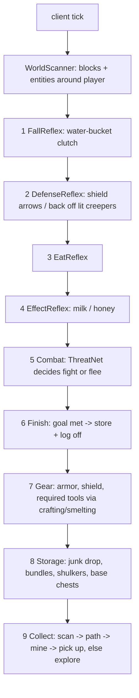

# autoCraft — build plan

Client-side Fabric mod. You give it resources + amounts; it survives, paths, mines, crafts tools,
stores loot and logs off when the goal is met.

## Stack
- Minecraft **26.3**, Fabric Loader 0.19.5, Fabric API, Java 25, Loom (`./gradlew build`, `./gradlew runClient`).
- Mojang names (26.x is unobfuscated — no mappings).
- No external AI libs: the neural net is a tiny MLP in plain Java.

## Commands (typed in chat, never sent to the server)
| Command | Effect |
|---|---|
| `!ac collect <resource> <amount> [<resource> <amount> ...]` | start a job (`diamond 10 iron 32 log 64`) |
| `!ac stop` / `!ac pause` / `!ac resume` | control the job |
| `!ac status` | progress, current behavior, health/food |
| `!ac base` | mark current position as the storage base (chests near it are used) |
| `!ac logoff on\|off` | disconnect when the job is done (default on) |
| `!ac goto <x> <y> <z>` | debug: pathfind to a block |
| `!ac resources` | list known resource names (any item id also works, e.g. `minecraft:oak_log`) |

## Architecture
One client-tick loop. Every tick the `Bot` releases all inputs, then asks behaviors **in priority
order**; the first that returns `true` owns the tick (subsumption). Lower behaviors keep their state
and resume when higher ones let go.

| Package | Responsibility |
|---|---|
| `com.autocraft` | entrypoint, `Bot` (job state, behavior loop), chat logging |
| `command` | `!ac` chat command parser |
| `goal` | `ResourceGoal` (stack of jobs; tool prerequisites are pushed on top), `Resources` registry |
| `world` | `WorldScanner` (section-skipping block scan, entity queries), `BlockUtil` (walkable/breakable/danger, break time) |
| `control` | `Controls` (keys, rotation, use/attack), `InvUtil` (find/select/swap/click/drop/equip) |
| `path` | A* `Pathfinder` (walk, diagonal, jump-up, descend/staircase, safe fall ≤3 or into water, dig-down, pillar, bridge, mine-through), goals, `PathExecutor`, `Navigator` |
| `behavior` | the priority behaviors above |
| `ai` | `ThreatNet` MLP + online training, persisted to `config/autocraft/threatnet.json` |
| `craft` | hardcoded recipes, `CraftPlanner` (what to gather/craft/smelt next), `Crafter` (2x2 / table), `Smelter` (furnace) |

### Neural net (ThreatNet)
Inputs: own health, armor, best weapon damage, shield, food, hostile count, nearest distance, summed
mob danger, creeper nearby, ranged count, night. 12 tanh hidden units, sigmoid output = “fighting is a
good idea”. Bootstrapped on synthetic samples from a hand-written teacher so it is sane on first run,
then updated online after every fight (won without losing >50% health → 1, else → 0) and saved.

## Phases (each ends with something runnable in-game)
1. **Skeleton** — Gradle/Loom project, entrypoint, `!ac` commands, `Bot` loop, logging. ✅ target: commands answer in chat.
2. **Movement** — `Controls`, `BlockUtil`, A* pathfinder + executor, `!ac goto`. ✅ walks, jumps, staircases down, pillars up, mines through walls.
3. **Collection** — resource registry, scanner, mine + pick up drops, explore (go to ore Y level and tunnel; walk the surface for surface resources), progress counting, log off on completion.
4. **Survival** — fall clutch, eating, milk, shield/back-off, combat with ThreatNet fight/flee.
5. **Tools & crafting** — required pickaxe tier detection, recipe planner, 2x2 + crafting table crafting, furnace smelting, armor/shield equip, replace broken tools.
6. **Storage** — junk dropping, bundles, shulker boxes, base chests (`!ac base`) with deposited counts toward the goal.
7. **Travel** — boats over water and ice for long exploration legs.
8. **Hardening** — stuck recovery, unreachable-target blacklist, lava/water safety, tuning from logs.

Phases 1–6 are the first milestone; 7–8 follow.

## Known limits / non-goals (for now)
- Servers with anti-xray or strict anti-cheat will fight the bot (scanning sees hidden ores; rotations snap).
- Nether/End travel, enchanting, villager trading, elytra are out of scope.
- Crafted end-products (e.g. “iron ingots”) are produced via the planner only for tool needs; jobs target
  gatherable items.
