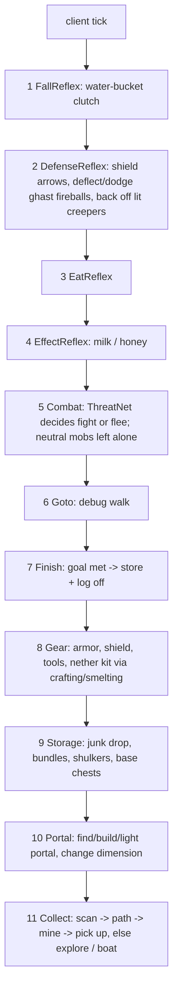

# autoCraft — build plan

Client-side Fabric mod. You give it resources + amounts; it survives, paths, mines, crafts tools,
travels to the Nether when a resource lives there, stores loot and logs off when the goal is met.

## Stack
- Minecraft **26.3**, Fabric Loader 0.19.5, Fabric API, Java 25, Loom (`./gradlew build`, `./gradlew runClient`).
- Mojang names (26.x is unobfuscated — no mappings).
- No external AI libs: the neural net is a tiny MLP in plain Java.

## Commands (typed in chat, never sent to the server)
| Command | Effect |
|---|---|
| `!ac collect <resource> <amount> [<resource> <amount> ...]` | start a job (`diamond 10 iron 32 quartz 64`) |
| `!ac stop` / `!ac pause` / `!ac resume` | control the job |
| `!ac status` | progress, current behavior, prerequisite, health/food |
| `!ac base` | mark current position as the storage base (chests near it are used) |
| `!ac logoff on\|off` | disconnect when the job is done (default on) |
| `!ac goto <x> <y> <z>` | debug: pathfind to a block |
| `!ac resources` | list known resource names (any block item id also works, e.g. `minecraft:oak_log`) |

## Architecture
One client-tick loop. Every tick the `Bot` releases all inputs, then asks behaviors **in priority
order**; the first that returns `true` owns the tick (subsumption). Lower behaviors keep their state
and resume when higher ones let go. Planners that need materials (tools, portal obsidian) post a
**need** on the bot; the collector serves needs before the job.

| Package | Responsibility |
|---|---|
| `com.autocraft` | entrypoint, `Bot` (job, needs, behavior loop), chat logging |
| `command` | `!ac` chat command parser |
| `goal` | `Job`, `Requirement` (items, source blocks, strategy, Y level, dimension), `Resources` registry |
| `world` | `WorldScanner` (section-skipping block scan, entity queries), `BlockUtil` (walkable/breakable/danger, break time) |
| `control` | `Controls` (keys, rotation, mine/attack/place/use), `InvUtil` (find/select/swap/click/drop) |
| `path` | A* `Pathfinder` (walk, diagonal, jump-up, staircase down, safe fall, dig-down, pillar, bridge, mine-through, swim), goals, executor, `Navigator` |
| `behavior` | the priority behaviors above + `Harvest` (walk → mine → pick up) |
| `ai` | `ThreatNet` MLP + online training, persisted to `config/autocraft/threatnet.json` |
| `craft` | hardcoded recipes, planner (what to gather/craft/smelt next), 2x2 / table crafting, furnace smelting |
| `travel` | boats over water/ice, nether portals (find, build, light, enter, return) |

### Neural net (ThreatNet)
Inputs: own health, armor, best weapon damage, shield, food, hostile count, nearest distance, summed
mob danger, creeper nearby, ranged count, night/nether. Small tanh hidden layer, sigmoid output =
“fighting is a good idea”. Bootstrapped on synthetic samples from a hand-written teacher so it is
sane on first run, then updated online after every fight (won without losing >50% health → 1,
else → 0) and saved.

## Phases (each ends with something runnable in-game)
1. **Skeleton** — Gradle/Loom project, entrypoint, `!ac` commands, `Bot` loop, logging.
2. **Movement** — `Controls`, `BlockUtil`, A* pathfinder + executor, `!ac goto`.
3. **Collection** — resource registry, scanner, mine + pick up drops, explore (ore Y level + tunnel; surface walk), progress, log off when done.
4. **Survival** — fall clutch, eating, milk, shield/back-off, combat with ThreatNet fight/flee.
5. **Tools & crafting** — pickaxe tier detection, recipe planner, 2x2 + table crafting, smelting, armor/shield, tool replacement.
6. **Storage** — junk dropping, bundles, shulker boxes, base chests (`!ac base`) with deposited counts toward the goal.
7. **Nether** — nether resources in the registry; nether kit (gold armor piece, flint and steel, food, blocks);
   obsidian by mining or water-on-lava casting; build + light portal or reuse a nearby one; enter, remember
   both portals, come back for base storage. Nether-safe pathing (lava, fire, soul sand, portals never walked
   into by accident). Nether mobs: deflect or dodge ghast fireballs, never provoke zombified piglins/endermen,
   piglins respected via gold armor, fight/flee blazes, wither skeletons, hoglins, magma cubes.
8. **Travel** — boats over water and ice for long exploration legs.
9. **Hardening** — stuck recovery, unreachable-target blacklist, tuning from logs.

Phases 1–8 are the first milestone; 9 is ongoing.

## Future goals
- **Elytra travel**: if an elytra is carried, use it for long trips; firework stock management (craft from
  paper + gunpowder), elytra durability checks with a safe-landing reserve.
- **Mending upkeep**: keep mending gear repaired by holding/wearing damaged mending items while collecting XP.
- **Biome-aware search**: read biomes to pick exploration targets for biome-specific or biome-rich resources
  (sand → desert/beach, clay → swamp/river, gold → badlands, emerald → mountains, mangrove → swamp).

## Known limits
- Servers with anti-xray or strict anti-cheat will fight the bot (scanning sees hidden ores; rotations snap).
- End travel, enchanting, villager trading are out of scope.
- Job targets are gatherable items; crafted items are produced only as tool/kit prerequisites.
